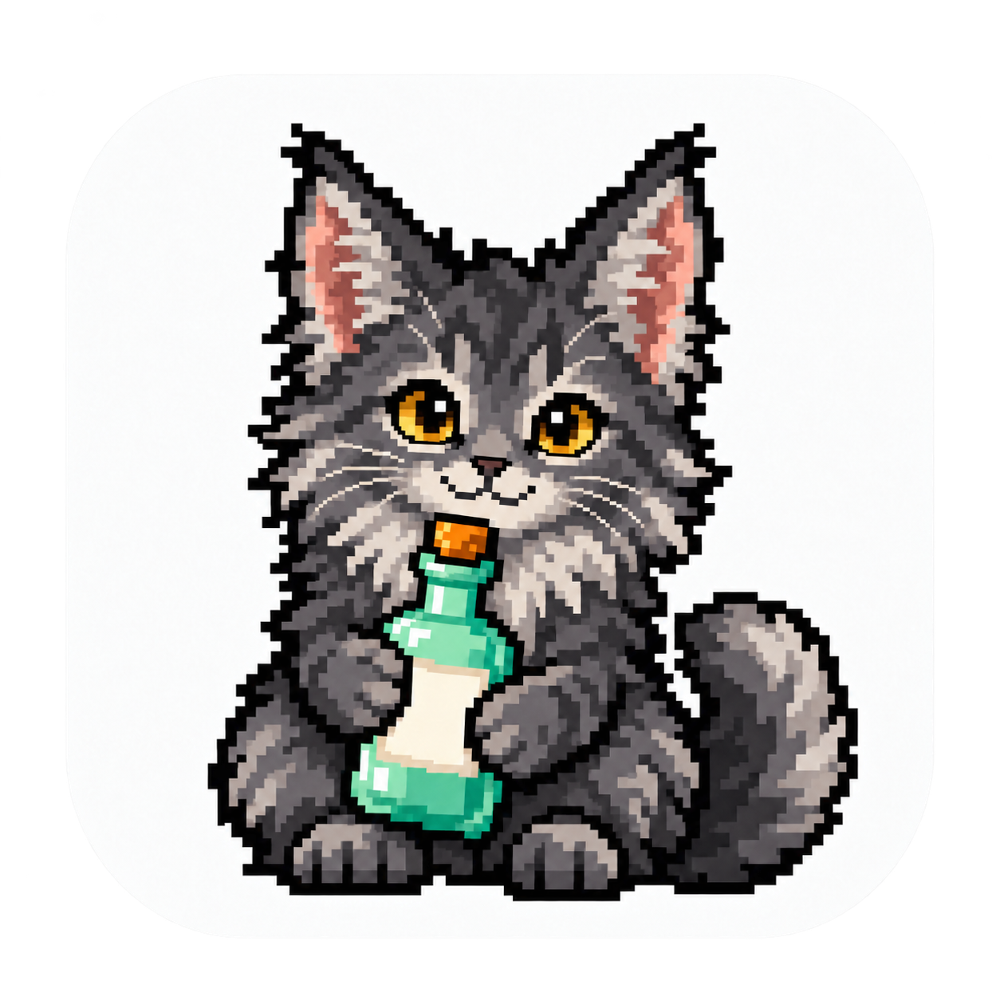

# Sipfolio



把酒瓶变成贴纸，把能复现的喝法收进配方册。

Sipfolio 是一款 macOS 本地酒瓶与鸡尾酒收藏应用。用自己的照片记录酒瓶，整理材料和制作步骤，以像素风收藏墙和酒单卡片浏览。手动收藏不需要账号或 API 密钥；AI 识别和公开资料查询是辅助功能。

*A local-first macOS bottle and cocktail collection app, built with SwiftUI, SwiftData and Vision. The interface is currently in Simplified Chinese.*

## 能做什么

- **藏酒屋**：导入或拖入照片，自动分离酒瓶并制作透明贴纸；多主体可选择，失败可使用原图。记录名称、自由类别、口味、年份、收藏日期与备注，支持搜索、排序、编辑和 PNG 导出。
- **杯中画**：浏览带成品照片的配方，自动寻找匹配封面，也可换图或导入自己的照片。保存照片背景、来源和署名。
- **调酒笺**：没有照片的配方以彩色文字酒单展示；补到照片后自动归入杯中画。
- **可复现的配方**：材料和实际制作步骤齐全才入册，只有名称的推荐会跳过。可换算的液体优先显示份数比例，原始用量始终保留，水果、冰块、“适量”等沿用原写法。
- **可选 AI**：通过 DeepSeek 识别酒瓶、补充酒款资料或生成配方草稿，核对后采用。密钥保存在 macOS 钥匙串。

同名酒瓶按「酒名＋口味＋年份」区分；口味是手动版本字段，AI 风味标签用于品鉴描述。配方可关联多个酒瓶，删除酒瓶不会删除配方。

## 安装与启动

目前提供源码构建，尚未提供经过公证的下载包或 App Store 版本。

需要一台运行 **macOS 14 或更新版本**的 Mac，以及带 **Swift 6.0 或更新版本**的完整 Xcode。只有 Command Line Tools 不够。工程使用 Swift Package Manager，无第三方 Swift 包依赖；可以在 Xcode 中打开 `Package.swift` 编辑。

```sh
git clone https://github.com/hyandnn/sip-portfolio.git
cd sip-portfolio
make release
open build/Sipfolio.app
```

生成的应用针对当前 Mac 的架构构建，采用本地 ad-hoc 签名。首次构建前，打开 Xcode 完成组件安装与许可确认。构建会优先使用所选的完整 Xcode，再尝试标准安装路径，不修改系统设置。自定义路径可指定：

```sh
make release XCODE_DIR="/path/to/Xcode.app/Contents/Developer"
```

## 第一次使用

1. 在藏酒屋点击「新收藏」（`⌘N`），选择或拖入一张自己的酒瓶照片。
2. 检查贴纸；需要时重新抠图、选择主体或保留原图。
3. 填写酒名、类别与备注，保存后从收藏墙打开详情。
4. 在配方册点击「新配方」手动记录材料与做法，或从酒瓶的推荐喝法创建。

保存酒瓶时可勾选收录已确认的推荐。应用先按名称查询公开做法，有材料与步骤才入册，再寻找照片。未匹配的推荐不占配方册；断网时可稍后重试。有做法但没有照片的配方仍可在调酒笺使用。

### 可选：启用 AI

在「Sipfolio → 设置」（`⌘,`）中输入自己的 DeepSeek API 密钥并检查连接。随后可在照片导入页点击「AI 识别并补充信息」，或在酒瓶详情补充资料。生成配方会填入可编辑草稿，修改确认后保存。

AI 调用使用自己的 DeepSeek 账户，可能产生费用。图片识别发送所选酒瓶图和酒名；配方生成发送喝法名称及关联酒瓶名称／类别。个人备注不进入这些请求。完整说明见 [隐私与联网行为](docs/PRIVACY.md)。

## 数据与备份

收藏数据库、照片及来源记录保存在：

```text
~/Library/Application Support/Sipfolio/
```

备份或迁移时先退出应用，再复制**整个目录**，不能只复制数据库文件。更新或重新构建不会清空收藏。API 密钥在钥匙串中，不包含在此目录；另一台 Mac 需要重新配置。

开发测试使用临时数据目录。需要手动体验隔离实例时：

```sh
build/Sipfolio.app/Contents/MacOS/Sipfolio --data-directory "$PWD/.local-data/demo"
```

目前没有内置的一键备份／恢复、云同步或 iOS 版本。存储结构和升级说明见 [项目结构](docs/PROJECT_HANDOFF.md)。

## 开发

```sh
make build     # Debug 构建并打包应用
make run       # 构建并打开应用
make test      # 完整测试，包含需要本机 Vision 的抠图测试
make test-ci   # 跳过需要 Neural Engine 的单项测试，供 CI 虚拟机使用
make audit     # 检查公开文件、私密信息模式与文档链接（需要 Python 3）
make icon      # 从仓库内的最终 PNG 重新生成图标
```

测试使用固定素材与模拟 HTTP，不需要密钥、个人收藏或在线服务。详情见 [开发指南](docs/DEVELOPMENT.md)、[测试与验收](docs/VALIDATION.md) 和 [贡献指南](CONTRIBUTING.md)。GitHub Actions 配置会检查仓库、执行 CI 测试并构建应用；本机完整测试另行覆盖 Vision。

## 来源与许可

源码与本项目图标按 [MIT](LICENSE) 提供。嵌入的 Fusion Pixel 字体、测试照片以及联网获取的数据和图片各有自己的许可，不自动适用 MIT；见 [第三方声明](THIRD_PARTY_NOTICES.md)。

公开配方来自 TheCocktailDB，补充图片来自 Wikimedia Commons 与 Openverse 索引的 Commons／Flickr。匹配依赖名称和图源元数据，可能与个人配方版本不同；可以主动换图。TheCocktailDB 当前使用官方开发测试接口，商店发布需按其要求配置生产访问。详见 [来源与使用范围](THIRD_PARTY_NOTICES.md#联网数据与图片)。

反馈问题请到 [GitHub Issues](https://github.com/hyandnn/sip-portfolio/issues)，提供复现步骤、系统版本和经过脱敏的截图。功能变更见 [CHANGELOG](CHANGELOG.md)，后续方向见 [ROADMAP](docs/ROADMAP.md)。
